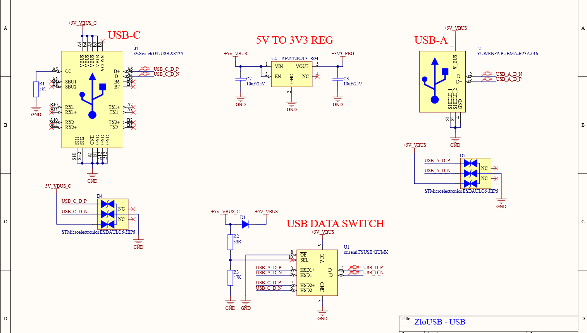
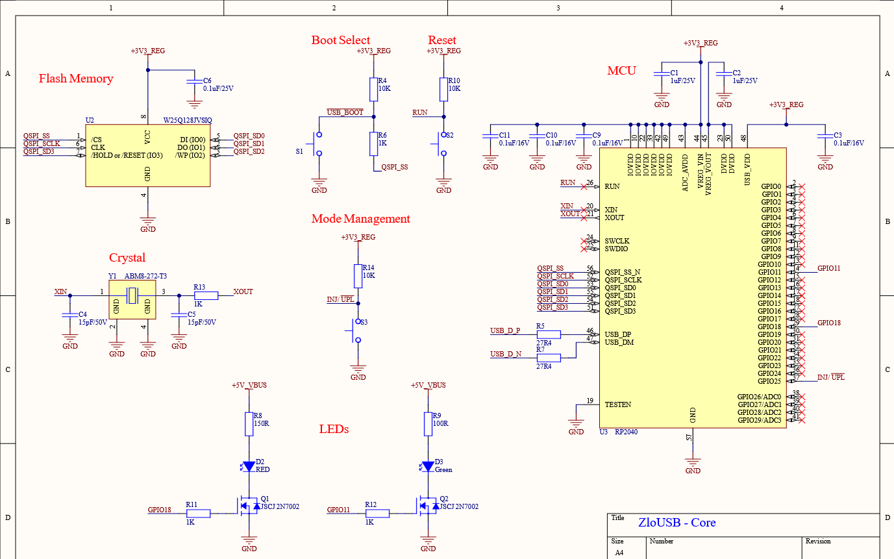
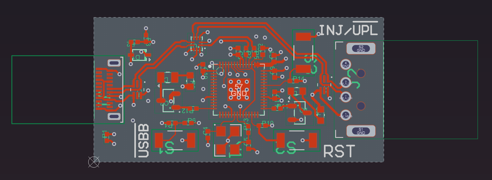
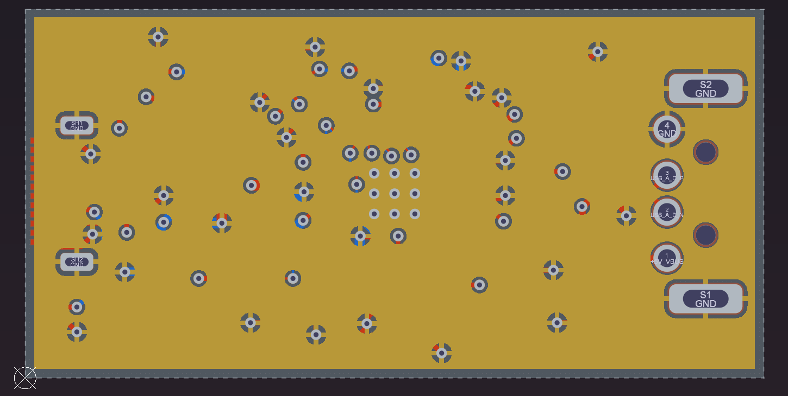
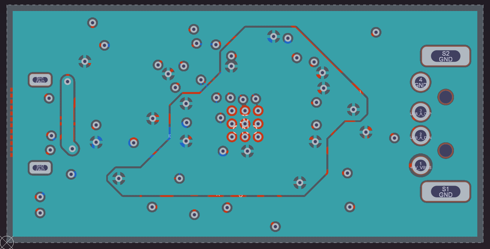
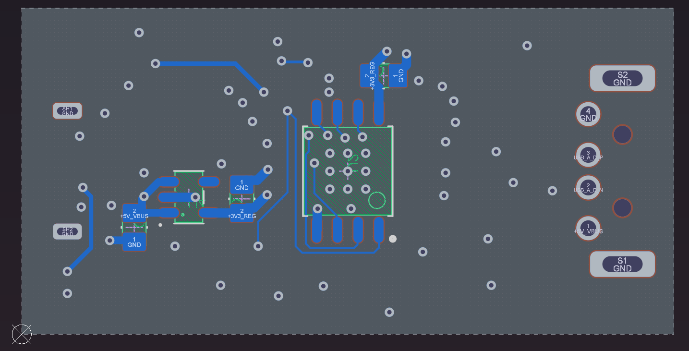

# ZloUSB

An HID keyboard emulator for keystroke injection like the USB Rubber Ducky or MalDuino.

Specifications:

- Small form factor - 40x20 mm.
- USB type A and type C plugs on separate sides.
- Payload storage on flash memory chip.
- Three operational modes - firmware flashing, payload management and payload injection. Controlled via switches.
- Two indicator LEDs - one red and one green. Red means injection mode, green means script upload mode. No LED means firmware flashing mode.

Problems encountered:

- The small form factor requires tiny components which cannot be soldered by hand using a soldering iron and necessitated the use of PCBA services.
- The small number of PCBs comes with very high production and assembly costs. To keep the costs to a minimum, the component selection had to be limited to JLCPCB's Economic Assembly components. This led to the use of components with poor documentation and awkward footprints. In the case of the USB type C plug, the original component was dropped from Economic Assembly during the layout process and had to be replaced. The new component had a poorly written datasheet and so some of the dimensions had to be guessed. This guess ultimately turned out to be wrong and the USB type C plug could not be soldered onto the PCB.
- JLCPCB does not support two-sided assembly as part of Economic Assembly. To avoid additional costs, the bottom side had to be soldered by hand. To make this as cost effective as possible, the components on the bottom side had to be chosen with larger footprints and some already available components were used (specifically decoupling capacitors and the voltage regulator) at the cost of non-ideal component parameters.

## Schematics

## Layers

PCB with four layers: Top, Ground, Power, Bottom.

### Top Layer

The top layer is the primary signal layer, responsible for USB data switching and transfer, boot mode configuration and indicator lights.

### Ground Layer

### Power Layer

### Bottom Layer

The bottom layer is the secondary signal layer, responsible for the flash memory as well as the voltage regulation.

